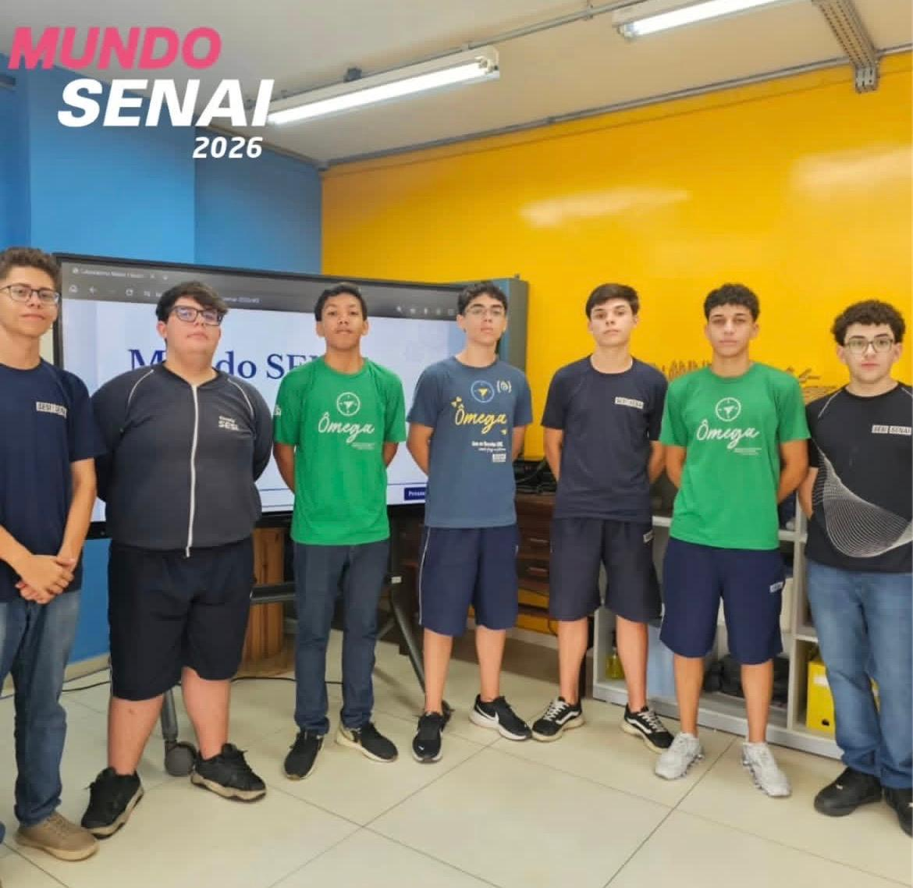

# Mundo SENAI 2026

Registro da minha participação no **Mundo SENAI 2026**, em **5 de novembro de 2026**, durante o curso técnico em **Informática para Internet** do SENAI.

## Registro do evento

Foto em grupo durante o Mundo SENAI 2026, em frente a uma tela de apresentação.

## O que é o Mundo SENAI

O Mundo SENAI é um evento que aproxima a comunidade da educação profissional, da tecnologia e das possibilidades de atuação na indústria. As unidades participantes recebem visitantes para conhecer cursos, ambientes de aprendizagem e atividades práticas.

Saiba mais em uma [página oficial do SENAI sobre o evento](https://www.sp.senai.br/unidade/saojosedoscampos/mundo-senai-2026).

## Sobre este registro

Esta pasta reúne o registro fotográfico e uma breve apresentação do evento como parte das entregas do meu portfólio do curso.

- **Data da participação:** 05/11/2026.
- **Curso:** Técnico em Informática para Internet.
- **Conteúdo:** registro fotográfico e documentação da participação.

## Portfólio

[Visitar meu portfólio](https://joaopmoreno.github.io/portfolio/)

[Voltar ao repositório do portfólio](../)
